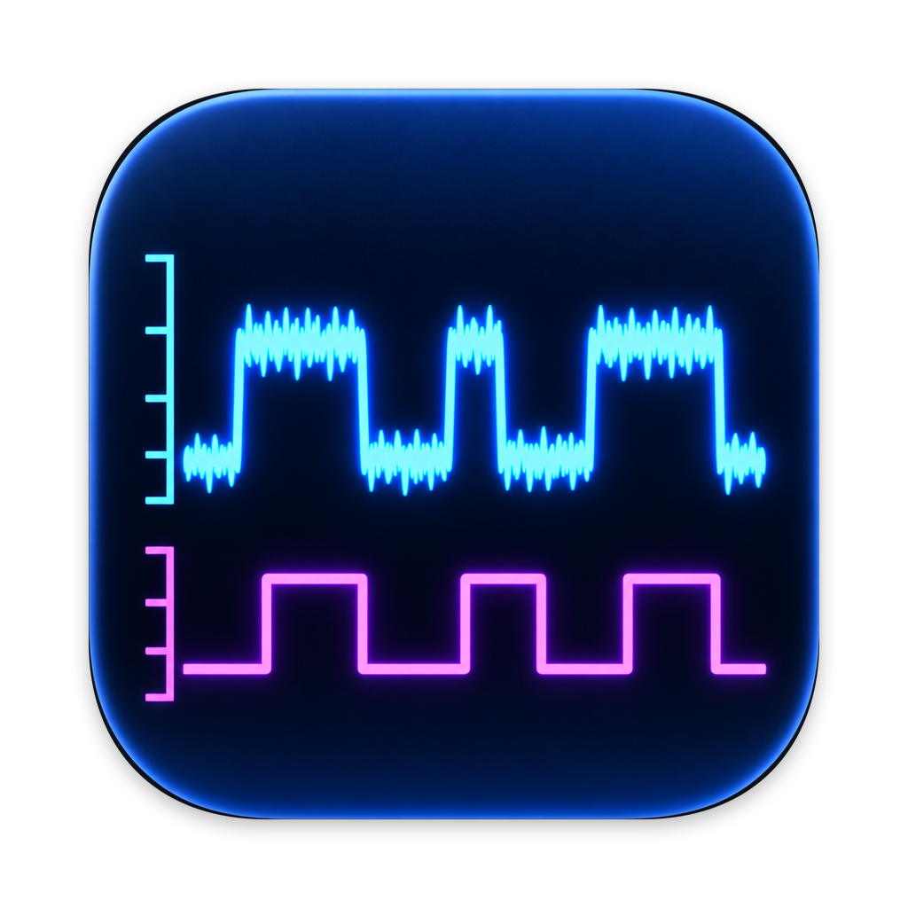
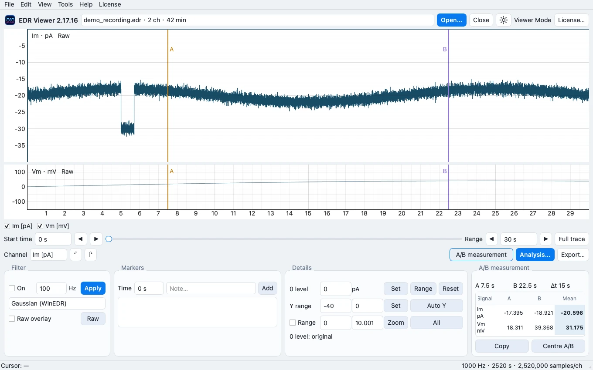
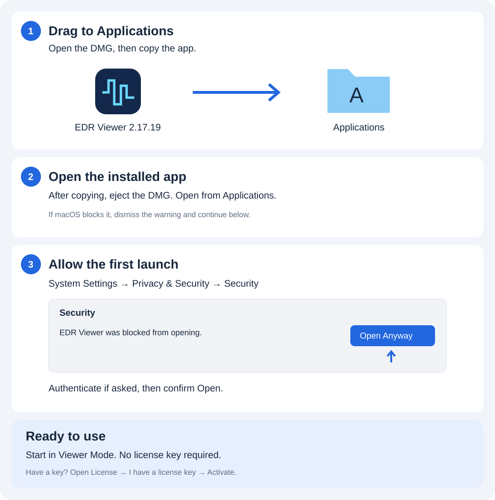

<h1 align="center">EDR Viewer 2.17.19 for Mac</h1>

Open EDR, ABF and ATF electrophysiology recordings on Mac.

macOS 14+ · Apple Silicon · 242.3 MiB · Test build · Not Apple notarized

<a href="https://github.com/Yize-Wu-99/edr-viewer-releases/releases/tag/v2.17.19">Release information</a> · <a href="INSTALL.md">Installation help</a> · <a href="https://edrviewer.yizewu555.workers.dev/">Website</a>

## EDR, ABF, ATF — and text data

Open recordings from **WinEDR and pCLAMP / Axon**. Supported imports: **EDR, ABF, ATF, TXT, CSV and TSV**. Text imports require regularly sampled numerical data; confirm columns, sampling rate and units when needed. Multi-sweep ABF files are opened one sweep at a time.

## Explore your recordings

| Light & dark views | Processing & analysis |
| --- | --- |
|  |  |
| Open recordings, inspect traces and measure A/B regions. | Full Access adds processing, FFT/PSD, exports and Analysis. |

*Screenshots show synthetic demonstration data and the existing website UI references; they are not new 2.17.19 validation results.*

## Install in three steps

**Open DMG → Drag to Applications → Open EDR Viewer**

See the illustrated installation guide

Only use Open Anyway if you trust the download. [Apple guidance](https://support.apple.com/en-gb/102445).

## Start free. Unlock more when ready.

**Viewer Mode:** opening recordings, trace inspection and A/B measurements.  
**Full Access:** processing, FFT/PSD, exports and Analysis. £7.99 one-time purchase, up to 2 Macs. Live checkout is still being prepared; this build retains test licensing configuration.

[Activate an existing key](ACTIVATION.md) · [Which file should I download?](DOWNLOAD.md) · [Support](https://edrviewer.yizewu555.workers.dev/support)

## Help and diagnostics

[Illustrated activation guide](https://edrviewer.yizewu555.workers.dev/activation) · [Report a problem](https://github.com/Yize-Wu-99/edr-viewer-releases/issues/new)

Choose Help → Diagnostics & support… → Copy diagnostics. Review before posting; reports are public. Do not include license keys, purchase emails or experimental data.
